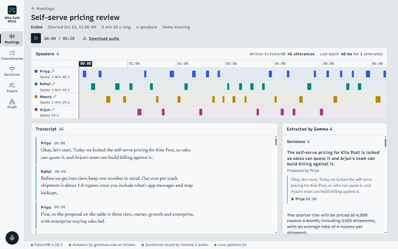
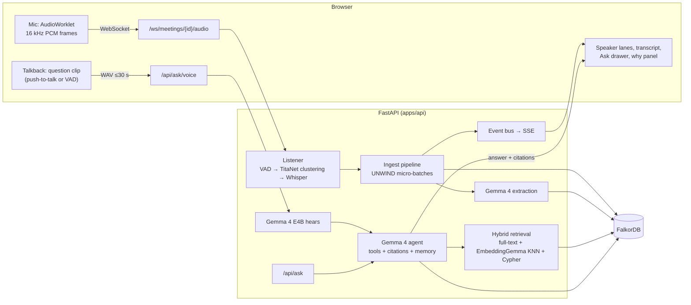
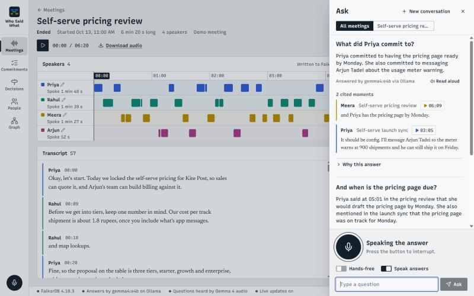

# Hack October - Who Said What Brain

**Every meeting, remembered by who said it.** A company brain whose only input is meetings. It listens live, works out who said what, writes every speaker-attributed line into a **FalkorDB** knowledge graph as it is spoken, and lets you **ask it out loud**. **Gemma 4** hears your question natively, answers aloud, cites the exact moment and speaker, remembers the conversation, and can act: mark an action item done, jump to the moment, or draft a follow-up.

> **Hacktoberfest Hack Day Bengaluru 2026.** Track 1: Best Use of Gemma 4. Primary problem statement **G2: Voice-First AI Interaction**.
> Product name lives in one place, [`brand.json`](brand.json). Rename the product there.



## What it does

| | |
|---|---|
| **Live "who said what"** | Mic or recording → Silero VAD → speaker embeddings (TitaNet) with online clustering → faster-whisper. Each line lands in FalkorDB within seconds, in UNWIND micro-batches, and appears on a multitrack of speaker lanes |
| **Gemma 4 reads the meeting as it happens** | Decisions, action items (owner + due date), topics and entities are extracted live and linked to the exact utterances that justify them. A later meeting that changes a decision **supersedes** it in the graph |
| **Ask by voice** | Hold the talkback button (or go hands-free). **Gemma 4 E4B hears the audio directly**: no separate speech-to-text on the question path. The spoken answer cites "Priya, Pricing review, 05:01" and the cited moment plays when tapped |
| **Conversation, not a search box** | "What did Priya commit to?" → "And when is that due?" → "Mark it done." Follow-ups resolve from session memory stored in the graph, and the last request updates the graph through a Gemma 4 tool call |
| **Verifiable** | Every answer has a "Why this answer" panel with the cited quotes, how each was found (full-text, vector, graph), the tools Gemma called, the exact Cypher that ran, timings, and the evidence subgraph |

Also included, from the team's earlier company-brain ideas (rebuilt here; see [Prior work](#prior-work-and-attribution)):
- a commitments board by owner;
- a decision log with supersession history;
- people and "who knows about…";
- a graph explorer;
- a Ctrl/Cmd+K command palette.

## How Gemma 4 is used

| Job | Model | Where | Why it matters |
|---|---|---|---|
| **Hear the spoken question** | `gemma4:e4b`, native audio input (Ollama) | presenter laptop, RTX 4060 8 GB | Short commands are heard correctly: "Mark it done" is heard as said, where Whisper heard "Market done" on the same clip. People's names from the graph are passed in as hints |
| **Answer and act** | `gemma4:e4b` locally, or `gemma-4-31b-it` via the Gemini API on the hosted URL | agent with native function calling | 8 tools: `search_meetings`, `list_action_items`, `complete_action_item`, `list_decisions`, `who_knows`, `summarize_meeting`, `seek_to`, `draft_follow_up` |
| **Understand the meeting live** | same | every ~6 utterances plus a final pass | Strict-JSON extraction with evidence ids that are validated against the window |
| **Embed for retrieval** | **EmbeddingGemma-300m** (ONNX, CPU) | server | 768-d vectors in a FalkorDB HNSW index, fused with full-text and graph lookups (reciprocal-rank fusion) |

The UI always labels which model did what: "Heard by Gemma 4 (audio)", "Answered by gemma4:e4b via Ollama", "Extracted by Gemma 4".

## Architecture



**Graph model** (full detail in [docs/STRATEGY.md §7](docs/STRATEGY.md)):
- `(:Meeting)-[:HAS_UTTERANCE]->(:Utterance)-[:SPOKEN_BY]->(:Speaker)-[:IS]->(:Person)`, plus `(:Utterance)-[:NEXT]->(:Utterance)`.
- `(:Decision)-[:EVIDENCED_BY]->(:Utterance)` and `(:Decision)-[:SUPERSEDES]->(:Decision)`.
- `(:ActionItem)-[:ASSIGNED_TO]->(:Speaker)`.
- `(:Utterance)-[:MENTIONS]->(:Topic|:Entity)`.
- `(:Turn)` nodes for conversation memory.
- Indexes: full-text on `Utterance.text`, HNSW vector on `Utterance.embedding`, range indexes on every id.

## Measured on the demo meetings

The two demo meetings ([demo/](demo/README.md)) are scripted Kitepost meetings voiced with four Kokoro-82M voices. They are run through the **real listener**, not pre-baked transcripts.

| Metric | Pricing review (6:20, 4 speakers) | Launch sync (3:56, 3 speakers) |
|---|---|---|
| Speaker attribution accuracy | 100% | 100% |
| Diarization error rate | 0.0% | 0.3% |
| Word error rate (faster-whisper small, CPU) | 3.1% | 2.7% |

Other measurements:
- **Live:** utterances appear in FalkorDB during playback. One count query run 12 s apart showed 1 → 5 → 7 utterances mid-stream. A batch write takes about 45 ms. A line lands about 2–3 s after the speaker pauses.
- **Ask:** about 2 s per answer on the laptop with `gemma4:e4b` (retrieval about 0.2 s). Hearing a spoken question takes another 0.5 s.
- **Tests:** 110 backend tests (graph, listener, brain, API) pass against live FalkorDB and Ollama.

The voices are synthetic, so these are an upper bound. Real rooms have overlap and noise; see the limitations below.

## Run it

**Prerequisites:**
- Windows, macOS or Linux.
- Python 3.12 with [uv](https://docs.astral.sh/uv/).
- Node 20+.
- FalkorDB, by any one of:
  - `docker compose up falkordb`;
  - `scripts/falkordb-wsl.sh start` on Windows without Docker;
  - FalkorDB Cloud.
- Gemma 4, by either:
  - `ollama pull gemma4:e4b` (needed for native audio questions);
  - a `GEMINI_API_KEY` for hosted `gemma-4-31b-it`.

```bash
cp .env.example .env                                   # optional; defaults work locally
uv run --project apps/api python scripts/fetch_models.py   # VAD + speaker-embedding ONNX (80 MB)
cd apps/web && npm ci && npm run build && cd ../..      # UI, served by the API
uv run --project apps/api python -m wsw_brain --port 8000
```

Open http://localhost:8000. On first start the two demo meetings are ingested through the real listener, which takes about 3–4 minutes with Ollama.

**More ways to run it:**
- Rehearse a "live" meeting from a file: `uv run --project apps/api python scripts/stream_wav.py demo/audio/02-launch-sync.ogg`.
- Development mode with hot reload: `cd apps/web && npm run dev` (port 5173, proxies to :8000).
- Tests: `cd apps/api && uv run pytest -q`. Use `-m "not live"` to skip the Ollama tests.

**Deploying the live URL:** see [docs/DEPLOY.md](docs/DEPLOY.md). Options are a Render Blueprint, any Docker host, or a no-account HTTPS tunnel from the laptop.

## Design

The UI is built around one idea from recording studios, the multitrack: one lane per speaker with blocks where they spoke. Design notes and tokens are in [docs/DESIGN.md](docs/DESIGN.md):
- **Type:** Recursive for the interface, Newsreader for quoted speech.
- **Colour:** a cool desk-grey palette; red appears only while recording.
- **Tokens:** everything reads from [`tokens.css`](apps/web/src/styles/tokens.css).



## Limitations (honest)

- **Overlapping speech** goes to one speaker. Similar voices can merge.
- **Real-room accuracy is not measured yet:** the demo audio is clean synthetic speech.
- **Live captions are segment-level.** A line appears after the speaker pauses, not word by word.
- **The hosted URL can't use Gemma's ears.** The Gemini API serves only the text-and-image Gemma 4 models, so spoken questions on the hosted URL are transcribed by Whisper first; the UI says so. The laptop demo uses Gemma 4 E4B native audio.
- **A small model's extraction varies run to run.** `gemma4:e4b` on 8 GB VRAM sometimes produces vague action items or records a reaffirmation as a change; `gemma-4-31b-it` is noticeably better.
- **Single process.** The event bus and live sessions live in memory.

## Prior work and attribution

The rules require that this project be built between 13 and 18 October 2026, and that contributions be described accurately. Hence this section.

- **All code in this repository was written from 15 October 2026 onward.** The commit history is the record.
- The team's earlier projects informed the **ideas only**. They are **not included** (git-ignored `reference/` folder) and **no code was copied** from them:
  - [Hydra-Of-Malice/who-said-what](https://github.com/Hydra-Of-Malice/who-said-what) (Sep–Oct 2026): an Android on-device meeting recorder with speaker attribution (Kotlin, sherpa-onnx).
  - [Hydra-Of-Malice/who-said-what-desktop](https://github.com/Hydra-Of-Malice/who-said-what-desktop) (Sep 2026): a Windows desktop transcriber with streaming NeMo diarization.
  - [Hydra-Of-Malice/FalkorDB](https://github.com/Hydra-Of-Malice/FalkorDB) ("Minutes", Oct 2026): a FalkorDB company brain over transcripts and email, with no audio.
- **How this project differs from them:**
  - It uses a new listener stack: sherpa-onnx Silero VAD, TitaNet embeddings with online clustering, and faster-whisper.
  - Live graph ingestion, voice-first Q&A with Gemma 4 native audio, and the tool-calling agent are new.
  - The web UI and all Cypher are new.
- **AI tools used:** this project was built with **Claude Code** (Anthropic), working with the team: research, architecture, code generation and review.
- **Open models and libraries:**

  | Component | Licence | Notes |
  |---|---|---|
  | Gemma 4 and EmbeddingGemma (Google) | Apache 2.0 | |
  | TitaNet-small and Silero VAD | CC-BY-4.0 / MIT | via sherpa-onnx (Apache 2.0) |
  | faster-whisper / Whisper | MIT | |
  | Kokoro-82M | Apache 2.0 | demo voices |
  | FalkorDB | SSPLv1 | **not** OSI open source; used as a database server |
  | FastAPI, React, Vite, react-force-graph | MIT | |
  | Recursive, Newsreader | SIL OFL | fonts |

## Licence

[Apache 2.0](LICENSE).
