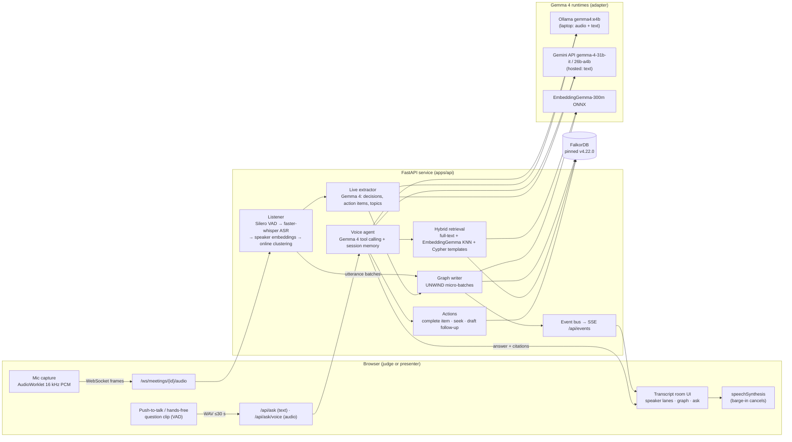

# Strategy: how "Hack October - Who Said What Brain" wins

Inputs:
- [HACKATHON_BRIEF.md](HACKATHON_BRIEF.md), built from the scraped handbook;
- [TECH_NOTES.md](TECH_NOTES.md), research with a fact-check ledger;
- [REPO_AUDIT.md](REPO_AUDIT.md), covering the three earlier repos.

Status: **locked 15 Oct 2026**. The team asked us to proceed without a checkpoint stop, so this file is the record of each decision and its reason.

## 1. The decision in one paragraph

We enter **Track 1: Best Use of Gemma 4**, primary problem statement **G2: Voice-First AI Interaction**. The product is a meeting-only company brain:

1. It listens to a meeting live.
2. It works out **who said what**.
3. It writes every speaker-attributed utterance into a **FalkorDB** knowledge graph as it happens.
4. People then **talk to it**. Gemma 4 hears the spoken question natively (audio input), keeps the conversation going across follow-ups, answers aloud with speaker and timestamp citations, and can take actions such as marking an action item done, jumping to the moment in the recording, or drafting a follow-up.

Gemma 4 does four jobs:
- **listening** (native audio input on E4B);
- **understanding the meeting** (live extraction of decisions, action items and topics);
- **reasoning** (a tool-calling agent over the graph);
- **embedding** (EmbeddingGemma, the Gemma family's retrieval model).

That makes Gemma 4 the core intelligence of the product, not a garnish.

## 2. Track ranking

Only three team prizes exist: Overall, Track 1 and Track 2. The eight problem statements are framing, not prize categories (HACKATHON_BRIEF §8). We may enter one track and one problem statement.

| Track / statement | Requirements (handbook) | Our fit (1–5) | Extra effort | Prize | Stackable with primary? |
|---|---|---|---|---|---|
| **T1 · G2 Voice-First AI Interaction** | Meaningful Gemma 4. Understands spoken requests, keeps conversational context, gives meaningful responses or actions | **5**: speech is our input *and* our interface; Gemma 4 E4B hears audio natively (verified on this laptop, §6) | Low: voice loop + actions on top of the brain | Arduino Uno Q per member + Overall eligibility | **Primary** |
| T1 · G3 Multimodal AI Intelligence | Reason across text, images and audio | 4: audio + text. Images would be a stretch (slide screenshots) | Medium | same | Shown as a supporting capability, not claimed |
| T1 · G1 Autonomous Multi-Agent Collaboration | Agents communicate, delegate and coordinate | 3: listener, extractor and answerer are separate workers, but not truly autonomous agents | High to make it honest | same | No |
| T1 · G5 Open Innovation with Gemma 4 | Gemma 4 as a core component | 4: true, but generic; weaker story than G2 | none | same | Fallback only if G2 is judged unclear |
| T2 · O3 Trustworthy and Verifiable AI | Users can verify AI output | 4: every answer cites utterances you can replay | Low | Arduino Uno Q per member + DEV badge | Not stackable (one track), but we *demonstrate* verifiability inside G2 |
| T2 · O2 Adaptive AI with Memory | Retains context and corrects itself | 4: graph memory plus decision supersession | Medium | same | Not stackable; shown as a passive feature |
| T2 · O1 Swarms, O5 Open innovation | — | 2–3 | — | same | No |

**Why Track 1 / G2 over Track 2:**
1. **Fit.** It is the team's stated goal and the strongest match. Voice is both the input (meetings) and the interface (talking to the brain).
2. **Rarity.** Track 2 needs an OSI licence on the repo, which is easy (Apache-2.0), but "open-source AI" is a crowded framing. Native-audio Gemma is rare: the research found **no hosted API serving an audio-capable Gemma 4** (TECH_NOTES §0.1). A working local Gemma 4 that hears questions is therefore a differentiator few teams will have.
3. **Overall prize.** It is open to every track. MLH's default criteria (Technology, Design, Completion, Learning, weighted equally; TECH_NOTES §5.4) reward a polished, working live demo, which this product is.

## 3. Rule compliance plan (the most important risk)

Rules:
- "Projects must be built between 13 and 18 October 2026."
- "Submit original work and accurately describe contributions."
- MLH rule 9: you may reuse an idea, **not code**.

All three earlier repos predate the window (REPO_AUDIT §3).

What we do:
1. **Fresh repo, fresh code.** Every line of product code in this repository is written from 15 Oct onward. The earlier repos sit in `reference/`, which is git-ignored and **never committed**. They are read only as design references.
2. **Different implementation, same ideas.** The earlier desktop app used NeMo Sortformer + multitalker Parakeet in a pywebview shell. This build uses:
   - sherpa-onnx (Silero VAD + speaker embeddings) with online clustering;
   - faster-whisper ASR;
   - a FastAPI service;
   - a new web UI;
   - a FalkorDB graph that none of the earlier speech apps had.
   The earlier "Minutes" graph project had no audio at all. Its features are re-implemented here in a smaller form (§8).
3. **Disclosure.** The README has a "Prior work and attribution" section linking the three repos, and it lists the AI tools used (Claude Code), as MLH requires.
4. **Granular history.** Many small commits from 15 Oct, pushed to a public repo. No pushes after the 3:30 PM deadline.
5. **Graph Hacks overlap.** The FalkorDB "Minutes" repo targeted Graph Hacks (15–18 Oct). This project is a different product and submission. **The team must not submit this repo to Graph Hacks**, and should confirm with the organisers if both events are being entered. This is an open question for the team (§10).

## 4. Judging map

Judging criteria are unpublished (handbook §5). MLH's defaults are Technology, Design, Completion and Learning. The handbook adds "demonstrate how your application works and how it uses the relevant AI capability". Expo judging gives about 2 minutes of demo plus 1 minute of questions (TECH_NOTES §5.4).

| Criterion | What scores it | Demo moment |
|---|---|---|
| Meaningful Gemma 4 use (handbook) | Gemma 4 hears, extracts, reasons and embeds. A "Gemma pipeline" strip on screen shows which Gemma model did each step | 0:20 live extraction; 1:10 spoken question answered |
| G2: understands spoken requests | Native-audio Gemma 4 E4B transcribes and interprets the question, with no separate ASR on the question path when local | 1:10 judge asks by voice |
| G2: maintains conversational context | Session memory: "and what did *she* say after that?" resolves from the previous answer | 1:35 follow-up question |
| G2: meaningful responses or actions | Spoken answer with citations, plus tool actions: mark action item done, jump the player to the cited moment, draft a follow-up | 1:50 "mark it done", then the graph updates |
| Technology | Live diarization → FalkorDB writes in micro-batches → hybrid retrieval (full-text + vector + Cypher templates) → cited answer. Cypher is visible in the "Why" panel | 0:40 live graph growing; 2:10 "Why this answer" |
| Design | Domain-native transcript-room UI: speaker lanes on a timeline, quoted citations, no generic AI look | throughout |
| Completion | Works end to end, on the live URL and the laptop; pre-ingested meetings so the URL works without the laptop | judges try the URL |
| Learning | Honest notes: what Gemma audio can and cannot do (≤30 s clips, text out), the FalkorDB engine pitfalls we avoided | Q&A |
| Verifiability (O3 framing, bonus) | Every claim links to the source utterance. Answers whose citations do not resolve are rejected and retried | 2:10 |

## 5. Architecture

**Model routing.** One adapter, chosen by environment variables:

| Job | Laptop (best) | Hosted URL | Offline / tests |
|---|---|---|---|
| Hear a spoken question | `gemma4:e4b` audio (Ollama) | faster-whisper on the server, then Gemma text. The UI labels which path ran | n/a |
| Answer / agent | `gemma-4-31b-it` via Gemini API if a key is set, else `gemma4:e4b` | `gemma-4-31b-it` via Gemini API | `fake` deterministic backend |
| Live extraction | same as answer | same | `fake` |
| Embeddings | EmbeddingGemma-300m ONNX (CPU) | same | hashing embedder |

## 6. Verified on this machine (15 Oct)

| Check | Result |
|---|---|
| Gemma 4 E4B native audio via Ollama 0.35.0 (`images` field carries the WAV) | Transcribed a TTS question exactly ("What did Priya commit to in the pricing meeting last Tuesday?") in 12.1 s, including warm-up |
| Gemma 4 E4B text decode speed | 14.2 tok/s (partial offload: the 6.5 GB q6/q8 build plus a 1 GB audio/vision projector on 8 GB VRAM). So on the laptop, keep answers short; on the hosted URL, use Gemini API 31B |
| Python stack (FastAPI, falkordb 1.8, sherpa-onnx 1.13.8, faster-whisper, onnxruntime 1.31, google-genai) | Installs and imports on Windows / Python 3.12 |
| Listener models | silero_vad.onnx, ERes2Net and TitaNet-small speaker embedding ONNX downloaded |
| Cached locally | EmbeddingGemma-300m ONNX, faster-whisper-small, gemma4:e4b |

## 7. FalkorDB graph schema

Graph per workspace: `wsw_<workspace>` (default `wsw_demo`). Pin the engine to `falkordb/falkordb:v4.22.0` (C engine). TECH_NOTES §2.1 explains why: the Rust 6.0.x engine has open silent wrong-result bugs. Every query keeps a `WITH` barrier between consecutive MATCH clauses, so it also runs safely on 6.0.x.

**Nodes:**

| Label | Key | Properties |
|---|---|---|
| `Meeting` | `id` | `title`, `started_at` (epoch ms), `ended_at`, `status` (`live` / `ended`), `source` (`mic` / `upload` / `demo`), `duration_s`, `summary` |
| `Speaker` | `id` (meeting-scoped track, e.g. `m1:S2`) | `label` ("Speaker 2"), `name` (after naming), `color_idx`, `centroid` (vecf32, voice embedding) |
| `Person` | `id` | `name`. A Speaker `IS` a Person once named; the same Person spans meetings |
| `Utterance` | `id` | `text`, `t_start`, `t_end` (seconds from meeting start), `seq`, `confidence`, `embedding` (vecf32 768-d, EmbeddingGemma) |
| `Topic` | `id` (slug) | `name` |
| `Decision` | `id` | `text`, `status` (`active` / `superseded`), `made_at` (meeting time s) |
| `ActionItem` | `id` | `text`, `owner_name`, `due`, `status` (`open` / `done`), `created_at`, `done_at` |
| `Entity` | `id` (slug) | `name`, `kind` (product / customer / vendor / org / other) |
| `Turn` | `id` | `session_id`, `role`, `text`, `at`. Voice-conversation memory |

**Relationships:**
- `(Meeting)-[:HAS_UTTERANCE]->(Utterance)` and `(Utterance)-[:NEXT]->(Utterance)`
- `(Utterance)-[:SPOKEN_BY]->(Speaker)`, `(Meeting)-[:HAS_SPEAKER]->(Speaker)` and `(Speaker)-[:IS]->(Person)`
- `(Utterance)-[:MENTIONS]->(Topic|Entity)`
- `(Decision)-[:DECIDED_IN]->(Meeting)`, `(Decision)-[:EVIDENCED_BY]->(Utterance)`, `(Decision)-[:PROPOSED_BY]->(Speaker)` and `(Decision)-[:SUPERSEDES]->(Decision)`
- `(ActionItem)-[:RAISED_IN]->(Meeting)`, `(ActionItem)-[:EVIDENCED_BY]->(Utterance)` and `(ActionItem)-[:ASSIGNED_TO]->(Speaker)`
- `(Meeting)-[:ABOUT]->(Topic)`

**Indexes:**
- Range on every `id`, plus `Utterance.t_start` and `ActionItem.status`.
- `CREATE FULLTEXT INDEX FOR (u:Utterance) ON (u.text)`.
- `CREATE VECTOR INDEX FOR (u:Utterance) ON (u.embedding) OPTIONS {dimension:768, similarityFunction:'cosine'}`.

## 8. Feature scope

**Headline (G2 + live ingestion):**
1. Live meeting room: mic or uploaded audio is diarized live. Speaker lanes grow on a timeline, and utterances land in FalkorDB in micro-batches, with an on-screen write counter.
2. Speaker naming: click "Speaker 2" → "Priya". The name propagates to the graph (`IS` Person).
3. Voice-first ask:
   - push-to-talk plus hands-free (VAD);
   - Gemma 4 hears the question;
   - session memory carries follow-ups;
   - the answer is spoken (speechSynthesis) with barge-in;
   - citation chips play the source moment.
4. Voice actions (Gemma function calling):
   - `search_meetings`, `list_action_items`, `complete_action_item`, `summarize_meeting`, `seek_to`, `draft_follow_up`.

**Passive features** (re-implemented in-window from the "Minutes" ideas, smaller):

5. Live extraction of decisions, action items, topics and entities by Gemma 4, with evidence links to utterances.
6. "Why this answer" panel: cited utterances, retrieval path, the Cypher that ran, and the evidence subgraph.
7. Decision history: a later decision on the same subject supersedes an earlier one (`SUPERSEDES`), shown as a chain.
8. Commitments board: open and done action items by owner across meetings.
9. Who-knows: which people talk most about a topic.
10. Graph explorer: the meeting's subgraph.
11. Command palette (Ctrl/Cmd+K) to jump to meetings or ask.

**Not building:** multi-tenancy/ACL, the A2A task board, the learned-skills store, email ingestion, or the bench page. They are noise for this event.

## 9. Demo script (3 minutes)

| Time | Beat | On screen |
|---|---|---|
| 0:00–0:15 | "Every company loses what was said in meetings. This brain remembers who said what, and you can just ask it." | Home: three past meetings, a speaker-lane preview |
| 0:15–0:45 | Start a live meeting. Two teammates talk for 25 s about a launch date and an owner | Speaker lanes appear live (S1, S2); the FalkorDB write counter ticks; a decision and an action item pop into the side rail, each labelled "extracted by Gemma 4" |
| 0:45–1:05 | Name the speakers by clicking; stop the meeting. Open the graph inspector | Utterances → Speakers → Persons; Decision `EVIDENCED_BY` an utterance |
| 1:05–1:35 | A judge presses the mic: "What did Priya commit to in the pricing review?" | Gemma 4 (native audio) shows its transcript chip; a spoken answer; citation "Priya, Self-serve pricing review, 05:01" (pricing page and FAQ by Monday) |
| 1:35–1:55 | Follow-up: "And when is that due?" | Context carried over; answer cites the due date |
| 1:55–2:15 | "Mark it done." | The action item flips to done in the commitments board (graph write) |
| 2:15–2:40 | "Why this answer" | Cited quotes, retrieval path (full-text + vector), Cypher, mini subgraph |
| 2:40–3:00 | Close: the hosted URL works for anyone, every Gemma step is labelled, and the stack is open-weight end to end | Pipeline strip |

## 10. Risks and mitigations

| Risk | Likelihood | Mitigation |
|---|---|---|
| Rule breach through pre-window code | Medium if careless | §3: fresh code only, `reference/` git-ignored, prior work disclosed |
| Graph Hacks double submission | Unknown | Team decision; do not submit this repo there |
| Gemma 4 E4B slow on 8 GB (14 tok/s) | High | Short answers; hosted 31B via Gemini API for answers when a key is present; audio-only use of E4B for questions |
| Live latency (ASR on CPU) | Medium | faster-whisper small int8 on 24 threads; VAD-cut utterances ≤12 s; partial captions |
| Diarization errors (overlap, similar voices) | Medium | Online clustering with a conservative threshold plus merge-on-name; demo with close mics; show confidence honestly |
| Windows + Docker (stale sockets seen today) | Medium | `docker compose up` documented; fallback FalkorDB on any host via `FALKORDB_URL` |
| No hosted credentials in this environment (no Gemini key, no Vercel/Render login) | Certain today | The app runs locally end to end; the deploy is one Dockerfile + render.yaml; the team adds `GEMINI_API_KEY` and connects the repo (README §Deploy) |
| Venue Wi-Fi | Medium | Everything except the Gemini API runs offline on the laptop; Ollama is the fallback |
| Judging criteria unknown | Certain | Cover the MLH defaults and the handbook's "meaningful use"; rehearse the 2-minute version |

## 11. Build order (by demo value)

| # | Item | Estimate | Target |
|---|---|---|---|
| 1 | Brand constant, config, graph schema + writer + read queries, event bus | 3 h | 15 Oct |
| 2 | Listener: VAD → ASR → speaker clustering, file + WebSocket input | 4 h | 15 Oct |
| 3 | Gemma adapter (Ollama / Gemini / fake), EmbeddingGemma, live extraction | 3 h | 15 Oct |
| 4 | Retrieval + voice agent with tools, citations, session memory; `/api/ask` + `/api/ask/voice` | 4 h | 16 Oct |
| 5 | Web UI: meetings, live room, ask panel with voice, why panel, commitments, graph | 8 h | 16 Oct |
| 6 | Demo meeting (≥3 speakers, ≥5 min) generated + seeded | 2 h | 16 Oct |
| 7 | Docker compose, Dockerfile, render.yaml, README, prior-work disclosure | 2 h | 17 Oct |
| 8 | End-to-end verification, rehearsal, polish | rest | 17 Oct |
| 9 | Venue day: final fixes only, submit by 3:00 PM (30 min buffer) | — | 18 Oct |
